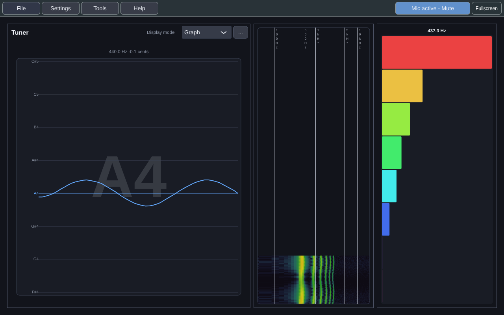
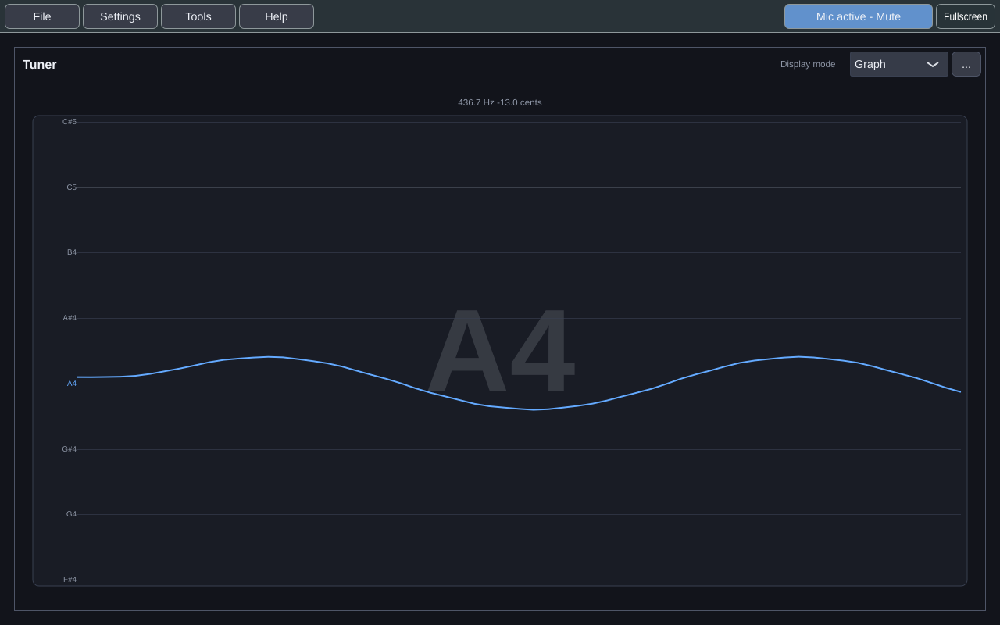
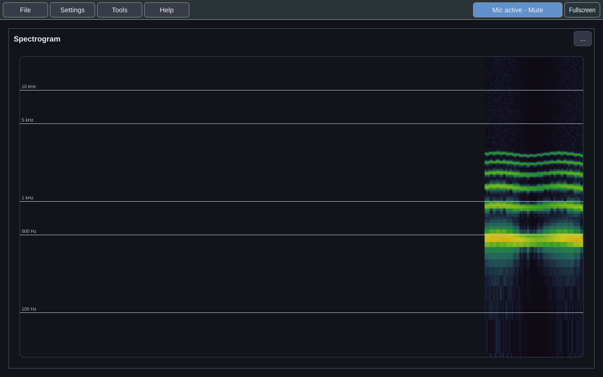
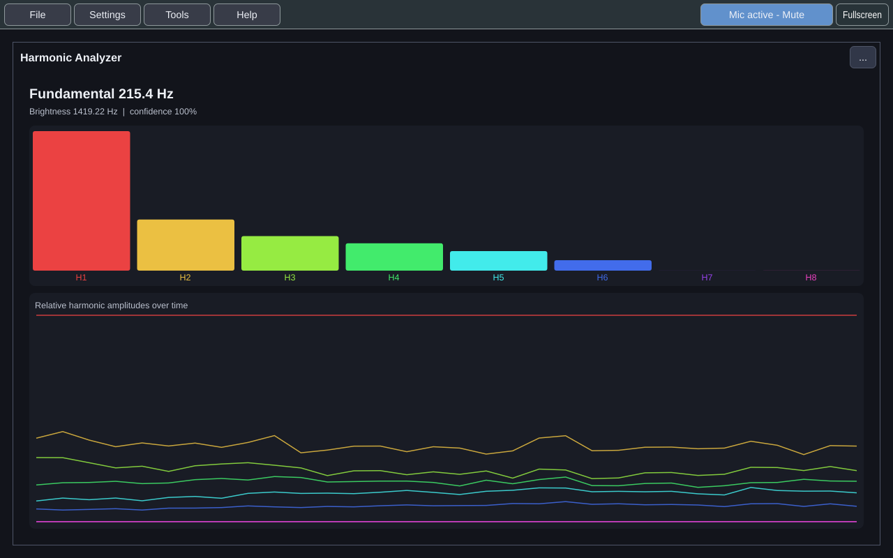
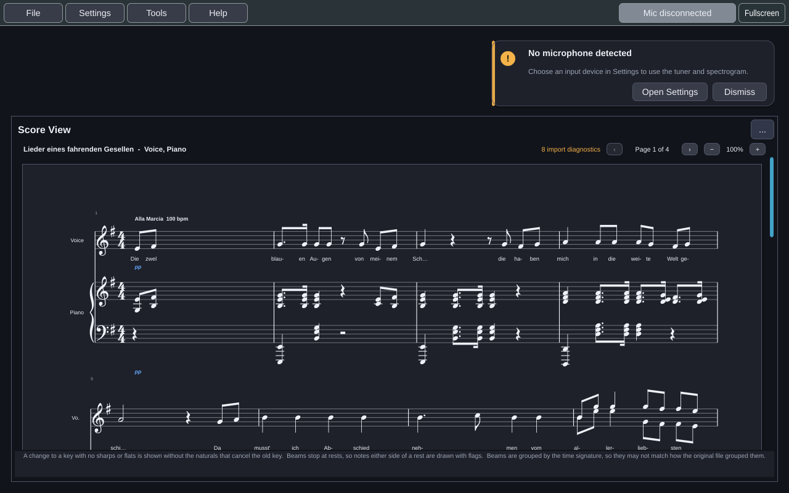

# Practice Takes

Practice Takes is a desktop music-practice application for Windows, Linux and
macOS. You play or sing, and it listens: a tuner, a spectrogram and a harmonic
analyzer for the microphone, an engraved score viewer for MusicXML, and live
capture of a MIDI keyboard and its sustain pedal.



> **Status: early, and not yet a viable product.** The tools below work, but
> what Practice Takes is for — play a piece, then see what went wrong in that
> take — doesn't exist yet. That is the MVP, committed for **17 May 2027**. The
> [roadmap](https://github.com/dwerkjem/PracticeTakes/wiki/Roadmap) has the
> dates and the [live forecast](https://github.com/dwerkjem/PracticeTakes/issues/10)
> says whether they're on track.

**User guide:** the [wiki](https://github.com/dwerkjem/PracticeTakes/wiki) ·
**Every feature, planned and done:** [Features](https://github.com/dwerkjem/PracticeTakes/wiki/Features)

## What it does today

### Listen

| | |
|---|---|
|  | **Tuner.** The note you're on, its frequency, and how many cents sharp or flat, as a pitch graph, a bar or a meter. Advanced settings shape how it settles, and practice presets set them for you. |
|  | **Spectrogram.** A scrolling view of the frequencies in the sound: harmonics, noise, resonance, and how a tone changes over time. |
|  | **Harmonic analyzer.** How strong each harmonic of a held note is, over time, with its fundamental and brightness. It says when it can't give a clean answer instead of guessing. |

### Read a score



**File → Open score...** reads MusicXML (`.musicxml`, `.xml`, `.mxl`), the
format every mainstream notation program exports. The **Score View** draws it as
engraved notation, in page, vertical or horizontal views, and an import summary
says exactly what came in differently from the file. **File → Open sample
score** opens a bundled song by Mahler if you just want to see it.

### Play a MIDI keyboard

Choose a keyboard under **Settings → MIDI** and Practice Takes reads its keys,
velocities and sustain pedal live, including notes held by the pedal. The MVP
uses this to judge each take against the score.

### Arrange it your way

Every tool can be docked in the main window, tiled beside the others, grouped as
tabs, or floated in its own window, without restarting it. Four built-in
workspaces get you started, you can save your own, and the whole setup exports
to a portable `.ptsettings` file. There is a dark theme and a light one.

## Where it's going

The MVP is built in two lanes at once:

- **Listening and pitch:** choose a target note, see the note you're on against
  it on a keyboard and a staff, find your vocal range, and sing against a drone.
- **Piano practice:** learn a piece at the keyboard, one hand at a time.

Both lead into one practice loop: play a piece on a MIDI keyboard, or sing your
part with the rest of the score as accompaniment; see on the score which notes
were wrong, missed, early or late, and how sharp or flat; loop the weak passage,
slower, and take it again.

After that come depth on both instruments, recordings examined with the same
tools as live input, ear-training drills, and, after 1.0, ear training and music
theory. The [Features](https://github.com/dwerkjem/PracticeTakes/wiki/Features)
page lists everything, by category, with the release it's planned for.

## Install

Published versions come from
[GitHub Releases](https://github.com/dwerkjem/PracticeTakes/releases) as native
installers, built for every platform below:

| Platform | Package |
|---|---|
| Windows x64 and ARM64 | `.exe` installer, with its runtime libraries, added to the Start Menu |
| Debian 12+ and compatible Ubuntu, x64 and ARM64 | `.deb`, which installs its dependencies through APT |
| macOS Intel and Apple Silicon | `.pkg`, installed into `/Applications` |

Then follow [Getting Started](https://github.com/dwerkjem/PracticeTakes/wiki/Getting-Started):
choose your microphone, open a tool, and pick a workspace.

## Feedback

Every tool's options menu has **Give feedback on this tool**, and the **Help**
menu opens the same form. It is the fastest way to change what gets built next.
Bugs and feature requests can also go to
[the issue tracker](https://github.com/dwerkjem/PracticeTakes/issues/new/choose);
security reports go through [`SECURITY.md`](.github/SECURITY.md).

## Development

Practice Takes is C++20 on JUCE 8, built with CMake. To build and run it on
Linux:

```bash
./tools/scripts/build/build-and-run.sh --install-dependencies
```

[Contributing](https://github.com/dwerkjem/PracticeTakes/wiki/Contributing) is
the short version. Developer documentation (architecture, builds on every
platform, code conventions, testing and releases) is in
[`docs/development/`](docs/development/README.md), and the
[architecture map](https://dwerkjem.github.io/PracticeTakes/) is a browsable
graph of the codebase with a guided tour.

## License

Practice Takes is available under the permissive
[BSD 3-Clause License](LICENSE).
