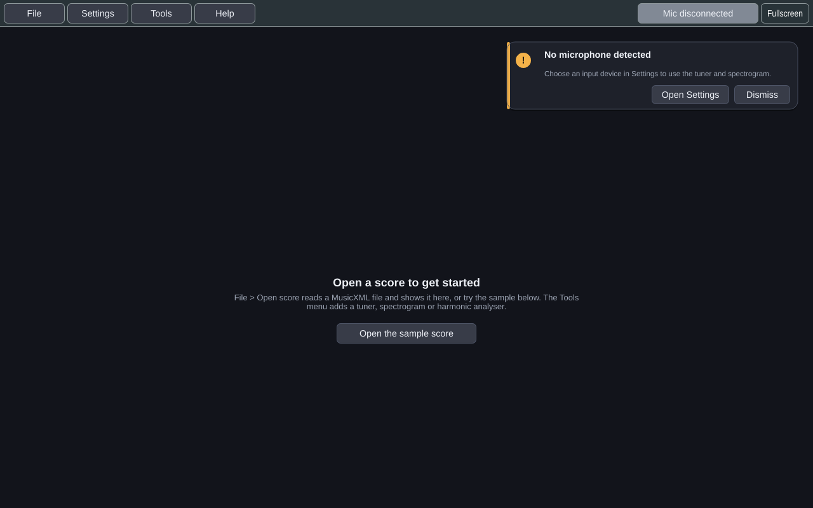
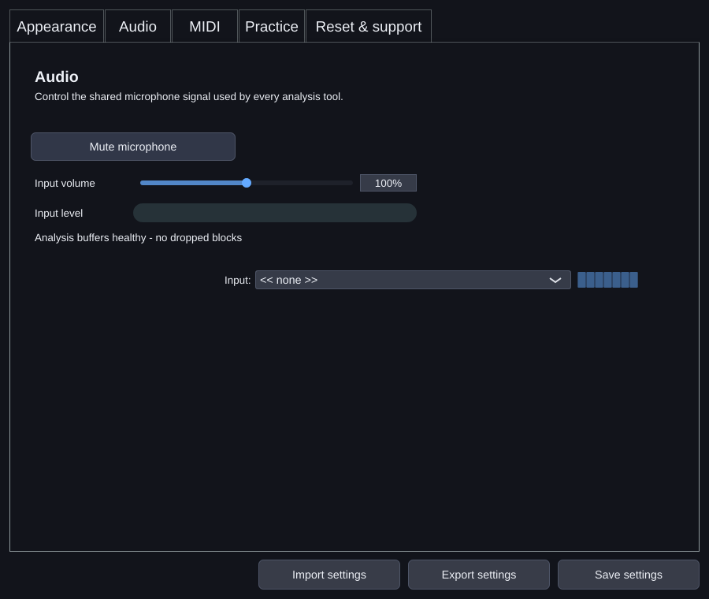
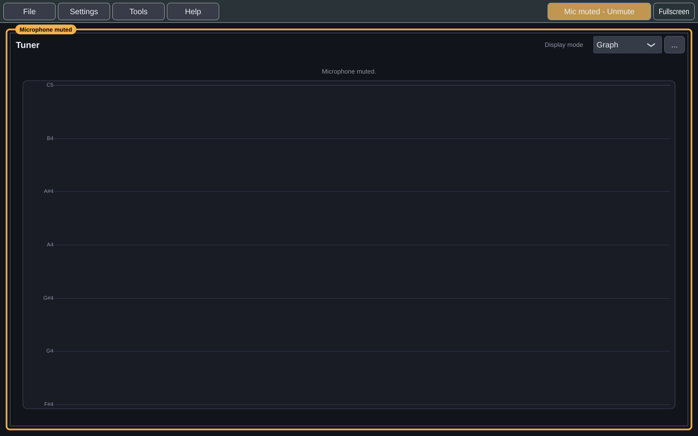
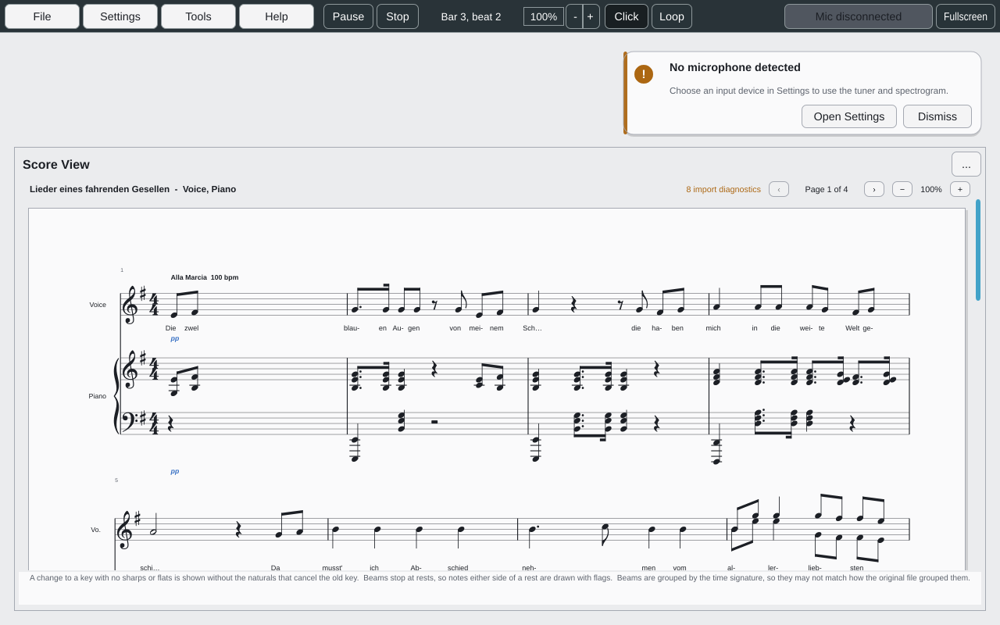
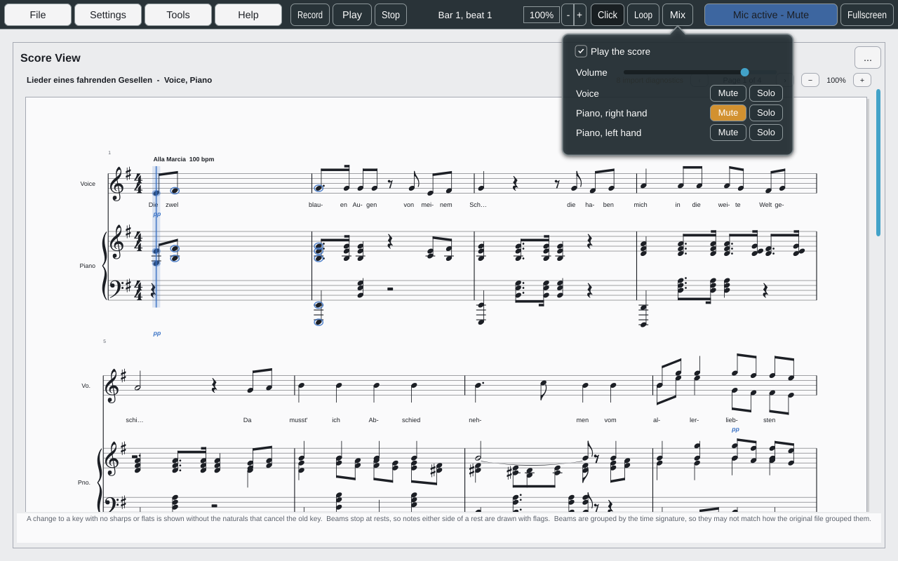
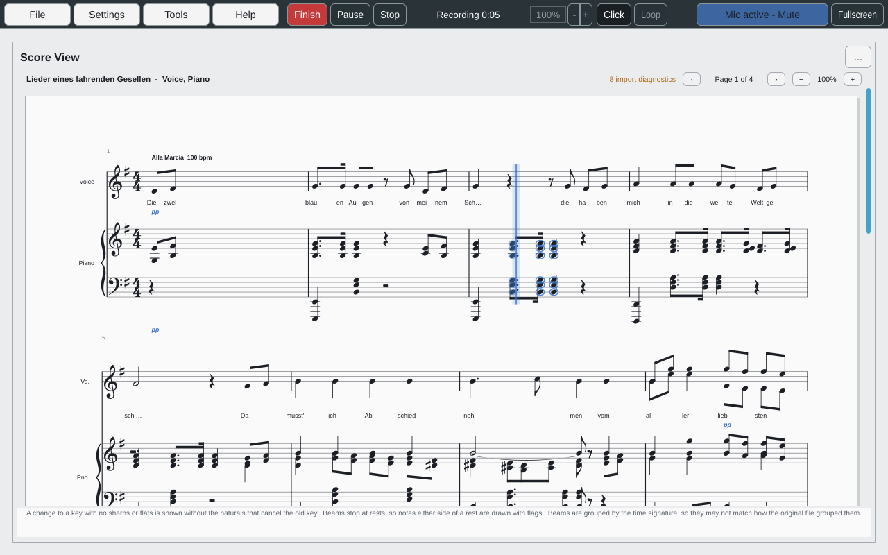
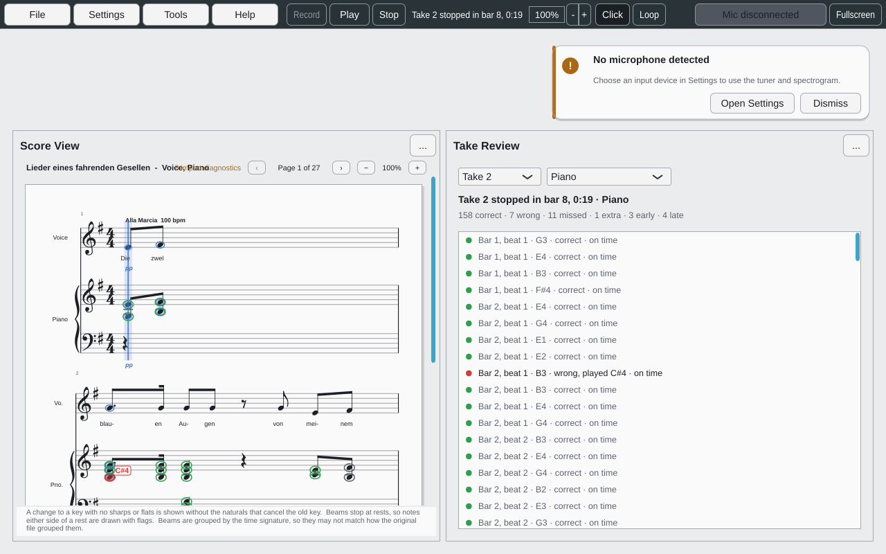

# Getting Started

## Install

Published versions come from
[GitHub Releases](https://github.com/dwerkjem/PracticeTakes/releases) as native
installers:

| Platform | Package | What it does |
|---|---|---|
| Windows x64 and ARM64 | `.exe` installer | Bundles the runtime libraries and adds Practice Takes to the Start Menu |
| Debian 12+ and compatible Ubuntu, x64 and ARM64 | `.deb` | Installs its dependencies through APT and adds Practice Takes to the Applications menu |
| macOS Intel and Apple Silicon | `.pkg` | Installs into `/Applications` |

To run something newer than the latest release, build it from source. See
[[Contributing]] for the short version and
[`BUILDING.md`](https://github.com/dwerkjem/PracticeTakes/blob/main/docs/development/build/BUILDING.md)
for the full one.

## First run

With no score and no tool open, the window offers **Open the sample score**. If
there is no usable microphone, a warning in the corner says so and links to
Settings:

1. **Choose your input.** Open **Settings → Audio** and pick a microphone. If
   there is no usable microphone, the main window shows a warning with a
   shortcut to Settings. **Input volume** is a software gain from 0 to 200%,
   shared by every tool, and never changes the operating system's own setting.

   

2. **Open a tool.** The **Tools** menu opens the Tuner, Spectrogram, Harmonic
   Analyzer, Score View and Target Note. Every tool listens to the same
   microphone, so several can be open at once. See [[Tools]].
3. **Pick a workspace.** **Tools → Workspaces** has four built-in arrangements:
   *Vocal Warm-up*, *Pitch Practice*, *Spectrum Analysis* and *Performance
   Preparation*. See [[Workspace and Settings]].
4. **Open a score** (optional). **File → Open score...** reads `.musicxml`,
   `.xml` and `.mxl`. **File → Open sample score** opens a bundled Mahler song if
   you just want to see it work. See [[Scores and MusicXML]].
5. **Connect a MIDI keyboard** (optional). Choose it under **Settings → MIDI**.
   See [[MIDI Keyboard]].

## The menus and the title bar

| Menu | Holds |
|---|---|
| **File** | Open a score, or the bundled sample |
| **Settings** | Appearance, audio and the metronome, MIDI, practice presets and the count-in, reset and support, and portable settings import/export |
| **Tools** | Opens each tool, arranges the workspace, and manages named workspaces |
| **Help** | Send feedback, and turn feedback invitations on or off |

On the right of the title bar, the **microphone button** shows the input's state
and mutes or unmutes it in one click: *Mic active - Mute*, *Mic muted - Unmute*,
or *Mic disconnected*. **Fullscreen** fills the screen, and becomes **Restore**.

While the microphone is muted, the button turns amber and an amber frame
labelled **Microphone muted** surrounds the whole workspace, so you can't sing
into a muted microphone without noticing:

## Playing along with a score

Once a score is open, the title bar shows the **transport** between the menus
and the microphone button. It drives one practice clock, which every tool
shares:

| Control | Does |
|---|---|
| **Play** / **Pause** | Starts the clock from where it is, counting in first, and holds it where it is. Pausing keeps your place. |
| **Stop** | Stops, and goes back to the start of the score, or of the loop |
| **Bar 3, beat 2** | Where the clock is in the score, or which count-in beat is sounding |
| **100%** | The tempo, as a percentage of the score's own, from 5% to 200% in steps of 5. **−** and **+** change it, even while playing, and the music carries on from the same beat. |
| **Click** | The metronome, on every beat, with the first beat of each bar accented |
| **Loop** | Plays the score round and round, starting again on exactly the same beat however many times it loops |
| **Mix** | Hear the score, and mute or solo each part, or each hand of a piano. See below |

The clock follows the score's own tempo changes and time signatures. A bar of
7/8 clicks seven times. The **count-in** is one bar by default, at the tempo
and time signature of the point you start from. You can change it to none or up
to four bars in **Settings → Practice**.

The metronome plays through the output device chosen in **Settings → Audio**,
where you also set its volume and turn the accent on or off. Muting the
microphone doesn't mute the metronome. With no output device, the clock still
runs, and Settings says why the metronome is silent.

### Hearing the score, one hand at a time

**Mix** opens a panel where the score can play along with the clock:

- **Play the score** turns it on. It is off until you turn it on, and is
  remembered.
- **Volume** sets how loud the score is, separately from the metronome.
- **Each part has a row**, and a piano has one per hand: *Piano, right hand*
  and *Piano, left hand*. **Mute** silences a row, and **Solo** plays only the
  soloed rows.

To practise one hand, mute it and play it yourself over the other. To hear one
hand on its own, solo it. Mute and Solo reset when you open another score.

The score plays at the tempo you've chosen, follows the loop and its count-in,
and is silent during the count-in. Each part plays the instrument its file
names, or a piano when it names none. The sounds come from GeneralUser GS, a
General MIDI bank that installs with Practice Takes.

**Use headphones while recording a take** with the score playing. The
microphone hears the speakers too, and so do the timing and note judgements.

## Recording a take

**Record**, at the left of the transport, records a take: what you play on a
MIDI keyboard and what the microphone hears, against the open score. It counts
in first, the same way Play does. Recording starts from the first click of the
count-in, so the first note is never cut off.

- The button turns red and reads **Finish**. The readout says *Counting in*,
  then *Recording 0:12*. Press **Finish** or **Stop** to end the take part-way,
  or let it play to the end of the piece.
- **Nothing can change under a take.** The tempo and **Loop** are greyed out
  and the clock can't be moved. The metronome stays yours to turn on or off.
- **Afterwards**, the readout says how the take ended, such as *Take 3 complete,
  1:05* or *Take 3 stopped in bar 14, 0:42*. A take stopped before the count-in
  finished isn't kept. Opening another score, or losing both the microphone and
  the keyboard, ends a take with the reason. Muting the microphone doesn't end
  one: it records silence.
- **Record needs something to record**: a microphone that isn't muted, or a
  keyboard chosen in **Settings → MIDI**. Without either it is greyed out, and
  its tooltip says why.

Takes are kept until you quit.

## Reviewing a take

When a take ends, Practice Takes judges it against the part you were playing:
the one your take matches best, so a pianist's take of a song is judged against
the piano. Open **Tools → Take Review** beside the Score View to see the result.

- **On the score**, every note you played is marked: a **green ring** if it was
  right, **red** with the key you pressed if it was wrong, a **grey ring** if
  you missed it, and an **orange arrow** beside it if it was early (pointing
  left) or late (pointing right). A **red ✕** above the staff is a key the score
  didn't ask for. **Show take review** in the Score View's options menu turns
  the marks off.
- **In the Take Review**, a summary counts each kind, and a list gives every
  result in order: *Bar 3, beat 2 · G4 · wrong, played A4 · 40 ms late*.
  **Click a result** to move the score and the transport there, ready to play
  that passage again.
- **Choose another take**, or **another part** to judge it against, at the top
  of the Take Review.

Only what the take covered is judged: a take stopped in bar 8 isn't missing
bar 9.

### A sung take

A take from the microphone is judged for timing, and each single note for
**how in tune it was**, against the reference pitch you sang at:

- **In tune** is a **green** ring when near perfect (within ±5 cents unless you
  change it), and a **blue**
  ring further off but still inside your acceptable range. **Sharp** or
  **flat** is an **amber** ring with an arrow above (sharp) or below (flat) and
  the cents beside it: *+35*. A note nearer another note than the written one
  is **wrong**, in **red**, with the note you sang. These are the same colours
  the Note View shows live.
- The list says it in words: *Bar 3, beat 2 · G4 · 35 ¢ sharp · on time*, or
  *in tune, +12 ¢* for a blue one, and the summary counts in tune, sharp and
  flat notes.
- What decides a note is its **held middle**. A scoop into it or a slide out
  of it isn't counted against you.
- A note the pitch tracker couldn't be sure of (breathy, very quiet, or noisy)
  is **pitch uncertain**, a faint ring, never wrong.
- Sing a treble line an octave down and it is still in tune; the list adds
  *an octave low*.
- **Settings → Practice → In tune within** sets how close counts as in tune:
  ±25 cents (a quarter of a semitone either way) unless you change it, from ±2
  to ±49. Changing it judges the take under review again. **Near perfect
  within** sets the green band inside it: ±5 cents unless you change it, from
  ±1 to ±20. **Out of tune beyond** sets where the live colours in the tuner
  and the Note View turn from amber to red: ±40 cents unless you change it,
  up to ±50. All three are plus or minus: ±5 means from 5 cents flat to 5
  cents sharp. Each stays inside the next: near perfect is always tighter than
  in tune, and in tune always tighter than out of tune. A sharp or flat note
  in the review is still amber; red there means a wrong note, nearer another
  one.

- **Settings → Practice → Ignore sound below** is the quietest sound a
  microphone take counts: −45 dB unless you change it. The room, breathing or a
  chair below it is never heard as a note, so never an extra one. Raise it in
  a noisy room; lower it if your quiet notes are missed. The meter beside it
  shows your microphone's level against that line: stay silent and set the
  line just above the room. The **Input Level** tool shows the same.

A chord heard through the microphone is judged for timing only: one voice is
one pitch.

## Telling us what you think

After a few completed tool uses, Practice Takes may ask once whether you'd like
to share feedback; **Help → Disable feedback invitations** turns that off. A
report is submitted online when it can be, and kept as a local draft when it
can't.
