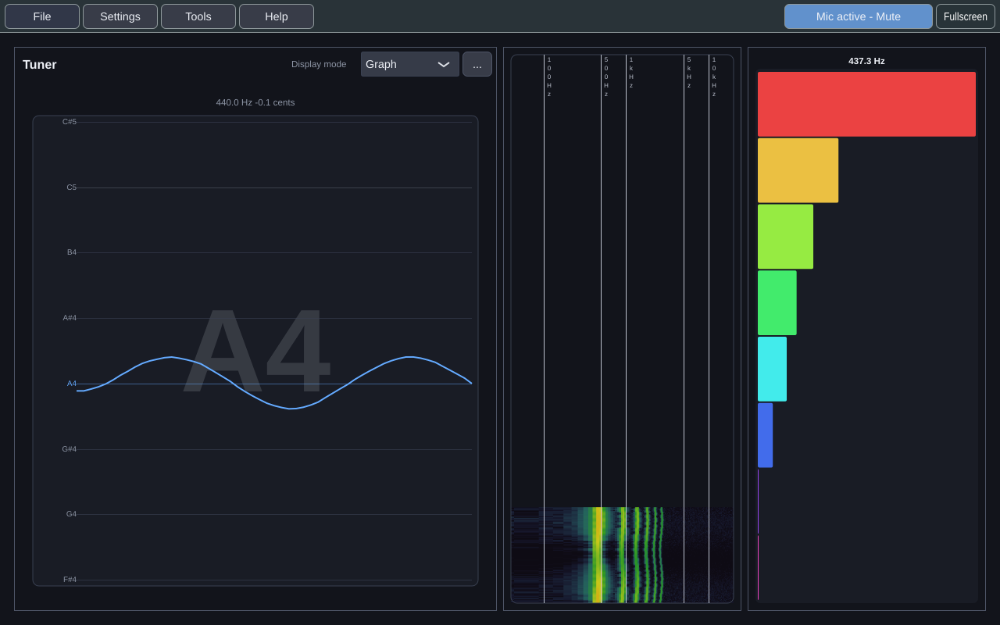

# Practice Takes

Practice Takes is a desktop music-practice application for Windows, Linux and
macOS. You play or sing, and it listens: a tuner, a spectrogram and a harmonic
analyzer for the microphone, a score viewer for MusicXML, and live capture of a
MIDI keyboard.

> **Status: early, and not yet a viable product.** The tools above work, but the
> thing Practice Takes is for (play a piece, then see what went wrong in that
> take) does not exist yet. That is the MVP, and the [[Roadmap]] says when it
> is committed to land.

## Where to go

| If you want to… | Read |
|---|---|
| Install it and open it for the first time | [[Getting Started]] |
| See every feature, what it's for, and when it lands | [[Features]] |
| Know what each tool shows | [[Tools]] |
| Dock, float, tile and save layouts | [[Workspace and Settings]] |
| Open a score, and know why a file came in differently | [[Scores and MusicXML]] |
| Find your songs and takes from earlier sessions | [[Library]] |
| Find a setting, a tool, a song or a line of the lyrics by typing | [[Search]] |
| Connect a MIDI keyboard and sustain pedal | [[MIDI Keyboard]] |
| Fix something that isn't working | [[Troubleshooting]] |
| See what's coming, and when | [[Roadmap]] |
| Build it, or contribute | [[Contributing]] · [[Architecture at a Glance]] |

## What the MVP will be

The MVP is built in two lanes at once. **Listening and pitch:** choose a
target note, see the note you're on against it on a keyboard and a staff, find
your vocal range, and sing against a reference tone or drone. **Piano
practice:** learn a piece at the keyboard, one hand at a time. Both lead into
one practice loop:

> Open a piece and choose a tempo. **Play it on a MIDI keyboard, or sing your
> part with the rest of the score as accompaniment.** Afterwards, see on the
> score which notes were wrong, missed, extra, early or late, and for a singer
> how sharp or flat. Then loop the weak passage, slower (or one hand at a time
> on the piano), and take it again.

It is committed for **17 May 2027**, with a planning target of 1 March 2027. The
listening and pitch tools don't need the rest of the loop, so each can ship on
its own as it lands.
The live forecast against that date is kept current in
[the roadmap issue](https://github.com/dwerkjem/PracticeTakes/issues/10).

## Feedback

Every tool's options menu has **Give feedback on this tool**, and the **Help**
menu opens the same form. It is the fastest way to change what gets built next.
Bugs and feature requests can also go to
[the issue tracker](https://github.com/dwerkjem/PracticeTakes/issues/new/choose).
Security reports go through
[`SECURITY.md`](https://github.com/dwerkjem/PracticeTakes/blob/main/.github/SECURITY.md)
instead.

---

*This wiki is generated from
[`docs/wiki/`](https://github.com/dwerkjem/PracticeTakes/tree/main/docs/wiki)
in the repository. Edits made here are overwritten. Change it with a pull request.*
