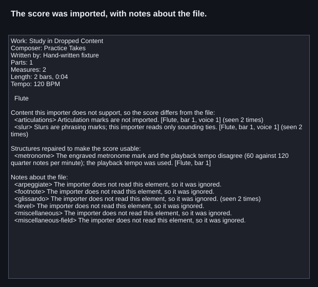
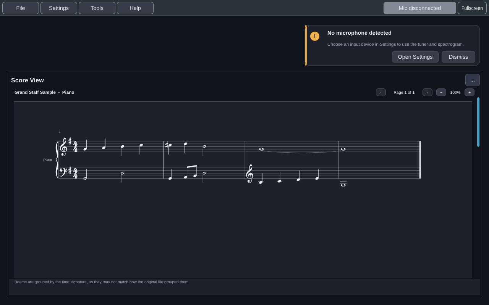

# Scores and MusicXML

Practice Takes reads scores in **MusicXML**, the format every mainstream
notation program exports: MuseScore, Sibelius, Finale, Dorico and others.

## Opening a score

**File → Open score...** reads:

| Extension | What it is |
|---|---|
| `.musicxml`, `.xml` | A MusicXML document |
| `.mxl` | Compressed MusicXML (a ZIP container) |

Whether a file is compressed is decided by its contents, not its extension, so
a mislabelled export still opens. **File → Open sample score** opens a bundled
song by Mahler, *Die zwei blauen Augen*.

Opening a score shows an **import summary**: anything that came in differently
from the file, grouped by severity, with the part and bar number. Score View
and Target Note then show the score.

## What is read

Parts and measures, notes and rests, voices and multiple staves (a piano part is
two staves on a grand staff), ties, tuplets, grace notes, chords, key and time
signatures, clefs, tempo marks, dynamics and lyrics. Transposing instruments are
handled, so a B♭ clarinet part sounds where it should.

## What is read but left out, with a note in the summary

Some notation is recognised and deliberately dropped. Each kind is reported once
with a count, not once per occurrence:

- slurs, articulations, ornaments and fingering;
- chord symbols and figured bass;
- percussion (unpitched) notes;
- multi-bar rests (imported as ordinary rests);
- page layout, fonts and instrument brackets, which the score view decides for
  itself.

Anything else the importer has never heard of is also counted by name and
reported once. That is how an unusual exporter shows up instead of silently
losing something.

**Pedal markings are not read.** Pedalling from a MIDI keyboard is shown, but
never compared with the score (see [[MIDI Keyboard]]).

## What is refused

| The file… | Why |
|---|---|
| is "timewise" MusicXML | Almost no program exports it; re-export as the usual *partwise* form |
| isn't MusicXML, or isn't well-formed XML | Nothing to read |
| is a ZIP without a valid `META-INF/container.xml` | Not a valid `.mxl` |
| is larger than 64 MB, expands past 256 MB, or compresses more than 200:1 | A protection against hostile files; a large orchestral score is a few megabytes |
| has no parts, or no notes and no rests at all | Not a score (a movement of nothing but rests is fine) |

Files are checked against Practice Takes' own structural rules, not validated
against the MusicXML schema. A file that bends the schema somewhere the importer
doesn't check still opens.

The precise contract is
[`musicxml-subset.md`](https://github.com/dwerkjem/PracticeTakes/blob/main/docs/development/formats/musicxml-subset.md).
