# Tools

Every tool opens from the **Tools** menu, can be docked in the main window or
floated in its own, and keeps running while you move it. Every microphone tool
shares the one input chosen in **Settings → Audio**. Each tool's options menu
also has **Give feedback on this tool**.

## Tuner

Listens to the microphone and shows the detected note, its frequency, and how
many cents sharp or flat it is.

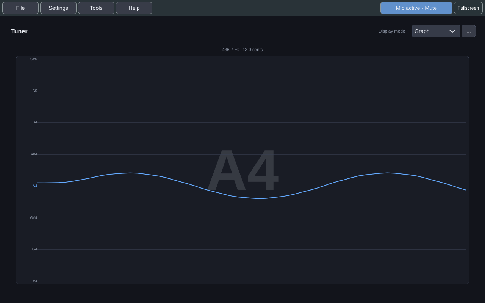

- **Display mode** picks one of three views:
  - **Graph**, pitch over time, so drift within a held note is visible (above);
  - **Bar**, the cents offset as a dot on a line, from −50 to +50 (one note)
    unless you change its scale;
  - **Meter**, a needle between *flat* and *sharp*.
- **The zones** show where you need to be, on all three views: bands around
  the note, each as wide as its range either side of it, all set in
  **Settings → Practice** and all plus or minus:
  - **green**, near perfect, within **Near perfect within** (±5 cents by
    default: from 5 cents flat to 5 cents sharp);
  - **blue**, in tune, within **In tune within** (±25 cents);
  - **amber**, near but off, out to **Out of tune beyond** (±40 cents);
  - **red**, out of tune: everything past that.

  Only the half of the zone you're in lights, the sharp half or the flat half,
  and it carries a **♯** or a **♭**, half the height of the note name, so you
  know which way to go as well as how far. On pitch, in the green, the sign
  goes away: there is nothing to correct. The tighter zones inside it stay
  faintly tinted, so you can still see the target; the looser ones outside it
  are turned off and leave only a dotted line, in their own colour, where each
  begins. Red is there only while you're in it, and then only faintly. The graph keeps the note's zones in view while
  you sing, and a marker on the bar and on the graph's newest point, and the
  meter's needle, take the colour of the zone you're in.
- **With a target note**, the zones are measured against the target rather
  than the note you're nearest: the bar and the meter are centred on it, the
  graph's axis is centred on its line, and singing a semitone off is red
  however in tune that other note is. Past either end of the bar or the meter
  an arrow at that end shows which side you're on.
- **The tool's ... menu** changes how that looks, for each tuner:
  - **Centre on the target note** (on by default): off, the tuner reads
    against the nearest note even with a target chosen;
  - **Signs**: *Off*, *Sharp and flat* (the default), or *Arrows: which way to
    go*, an arrow pointing back toward the note: left on the bar and the meter
    when you're sharp and right when you're flat, and down or up on the graph,
    whose pitch runs up the screen;
  - **Show how far off**, which writes the cents in the lit half, *−18 ¢*,
    beside the sign (off by default; the line above the display always gives
    the exact reading);
  - **Light both halves**, for a symmetric look that lights the whole zone;
  - **Marker**, what marks where you are on the bar and the graph: *Off*,
    *Dot* (the default), *Arrow*, *Line*, *Ring*, *Diamond* or *Crosshair*.

| Bar | Meter |
|---|---|
| 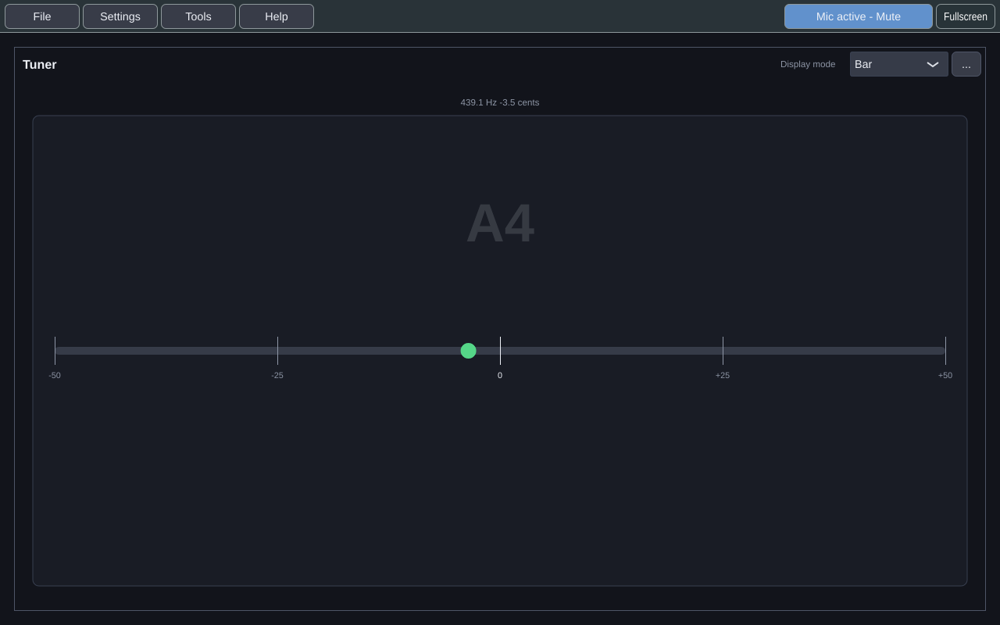 | 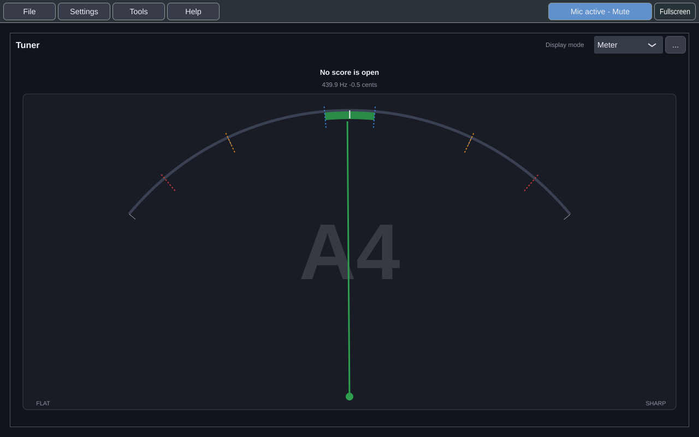 |

- **Advanced settings**, from the tool's **...** menu, tune how the reading
  behaves: *pitch easing* (smoothing), *average window*, *note switch* (how
  readily it moves to a new note), *dropout hold* (how long it holds through a
  gap), *graph duration*, and *bar/dial scale*: how far either way the bar
  and the meter reach, ±50 cents (one note) unless you change it, from ±10 to
  ±100. **Clear graph** starts the graph afresh.

  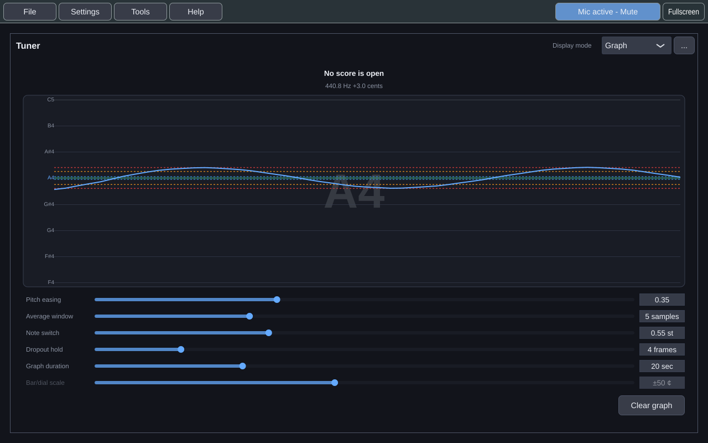

- **Settings → Practice → Practice preset** applies a coordinated set of these
  controls for the material you are practising.
- When the tool is small it shows less detail rather than cramming everything in.

It needs a sustained note: "Play or sing a sustained note" is what it says until
it hears one.

### The target note

Above the reading, the tuner names the note you're aiming at and where you are
against it:
- *Target E4 · on it*, within your near-perfect range (±5 cents by default),
  in green;
- *Target E4 · 16 ¢ flat*, within half a semitone;
- *Target E4 · 2 semitones below*, further away.

When a score opens, the target is its first note: the first note of its first
part that plays one note at a time, such as the voice of a song. A piano piece
has none, and the tuner says so, because a target is one note.

**Choose the target yourself** by clicking the target line, or with **Choose
target…** in the tuner's **...** menu:
- **click a key** on the keyboard;
- **click the staff**, after choosing ♭, ♮ or ♯ beside it;
- **type a name**, such as *F#4* or *Bb3*, and press **Set**;
- **sing or play it**, then press **Use the note I'm on**. It works once you
  have held one note steadily, within 30 cents, for a moment;
- **step** a semitone up or down, or a step of the score's key.

In the Score View, **right-click a note** and choose **Aim at G4**. For a chord,
pick which of its notes.

A target you choose is remembered when you quit. Opening a score replaces it
with the score's first note, unless **Settings → Practice → Keep my target when
a score opens** is on.

While the score plays, a target that came from the score **follows the note
being sung** in its part, so the tuner and the Note View always aim at the
note you should be on. A target you chose stays put. **Settings → Practice →
Target follows the score as it plays** turns this off.

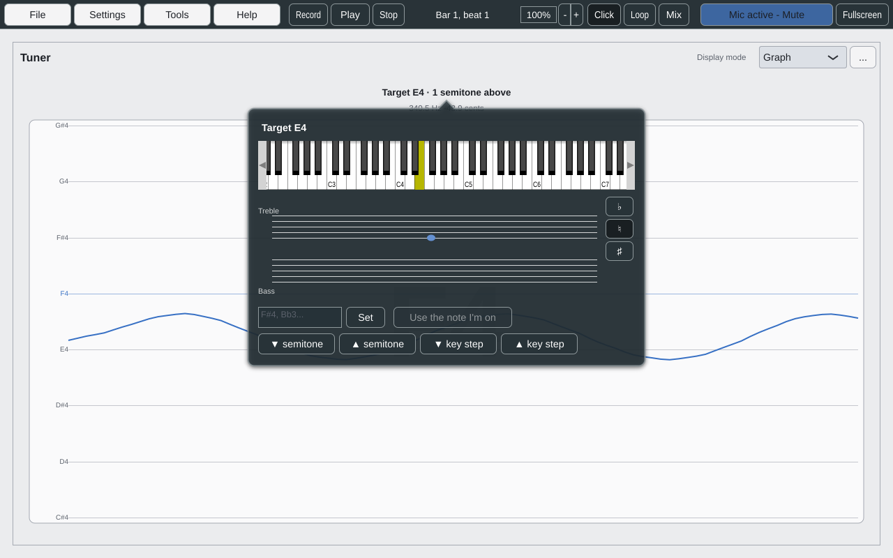

The tuner measures against the **reference pitch**, A4 = 440 Hz unless you
change it in **Settings → Practice** (from 415 to 466 Hz).

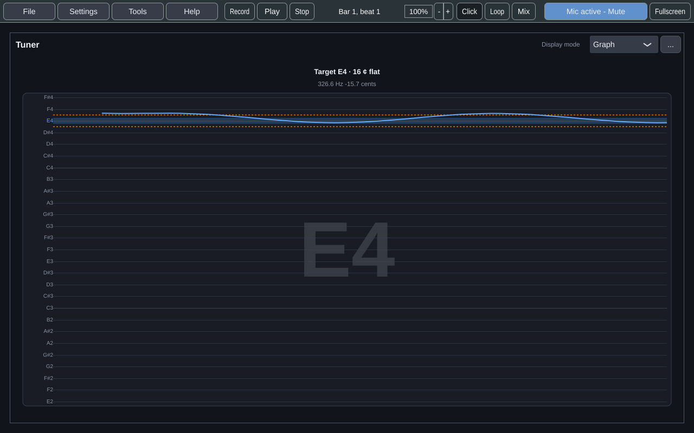

## Note View

Shows the note you're singing or playing the way a musician thinks of it:
- **On a keyboard:** the key you're on lights up in the colour of how close you
  are to the target (below). The target's key has a ring.
- **The acceptable range:** a band either side of the target's line, as wide
  as **Settings → Practice → In tune within** (±25 cents by default). It
  changes colour with the note you're on: **green** when you're near perfect
  (within **Near perfect within**, ±5 cents by default), **blue** inside the range, **amber** when you're near but
  off (out to **Out of tune beyond**, ±40 cents by default), **red** past that,
  and grey while nothing is sung. The key, the trail and your note on the staff take the same colour.
  Without a target, the colours are against the note you're nearest.
- **On a staff:** your note and the target side by side. The clef follows the
  note, or **Clef** in the **...** menu fixes it as treble, bass, or treble an
  octave down for tenor voices and guitar.
- **A trail:** the last three seconds of pitch drawn above the keys, so a scoop
  up to a note, or a drift off it, shows as a shape. The target's line runs
  down to its key.
- **The keys held** on a MIDI keyboard light purple, so it serves the piano
  too.

It reads pitch exactly as the tuner does, against the same reference pitch and
target. Small and docked, it shows the keyboard alone.

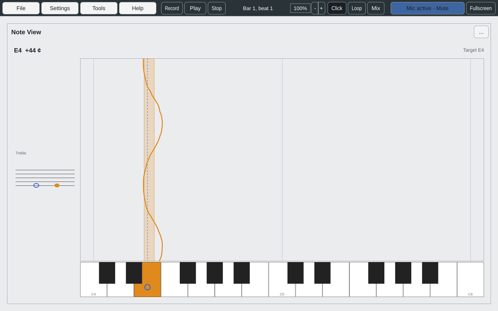

## Now & Next

The note to sing or play now, and the ones coming, large enough to read from a
music stand while you perform. It follows the clock: press **Play** or
**Record** and it moves with the score.

- **Now:** the note's name, large, with its lyric, a staff showing it, and how
  long it lasts in beats (*¾ beat*, *2 beats*). A bar along the bottom empties
  as the note runs out, with the seconds left. A rest says **Rest**, and a note
  held over a tie says *tied* and is shown once, for its whole length.
- **Next:** the following notes as cards. A rest is dimmed, a note sung again
  has an **again** badge, and a **’** breath mark and a gap come before each
  new phrase. The cards change only when the current note does, so they hold
  still to read.
- It changes note **when you hear it**: the playback position less your
  output device's latency.
- In the **...** menu:
  - **Look ahead:** how many notes to show (2, 4, 6 or 8).
  - **Follow part:** the target's part (the first one that plays one note at a
    time) unless you choose another.
  - **High contrast:** black, white and yellow, for a stage or a dim room.
- Small and docked, it shows just the current note, its time bar, and the next
  note's name.

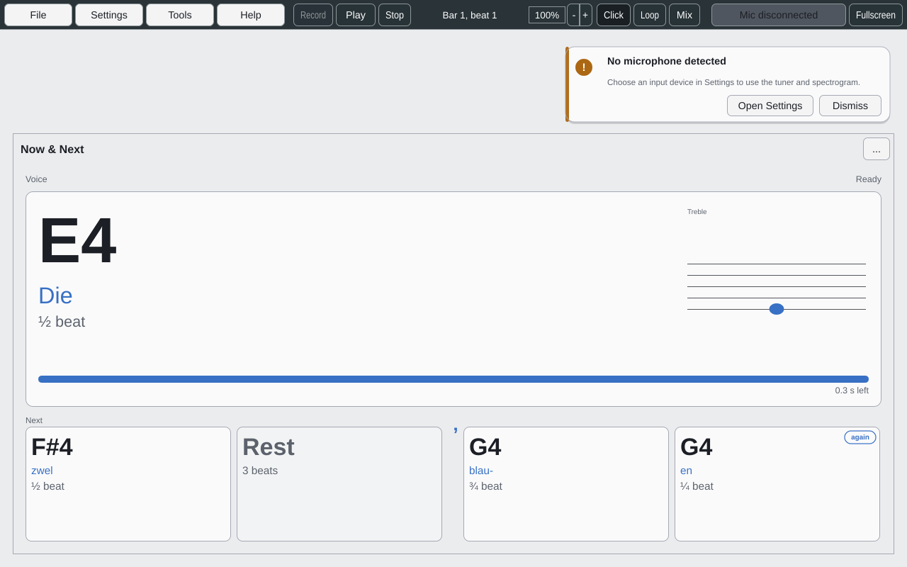

## Spectrogram

A scrolling frequency view of the microphone. It is useful for looking at
harmonics, noise, resonance and how a tone changes over time. Frequency is
marked from 100 Hz to 10 kHz on a logarithmic scale, rising up the screen. In a
tall, narrow panel the view turns on its side, so frequency runs left to right
and its labels read downwards, as in the picture on [[Home]].

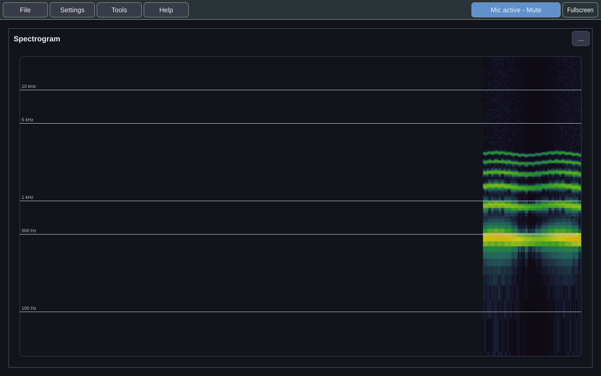

## Harmonic Analyzer

Shows the relative strength of a sustained note's harmonics over time, with its
fundamental and a brightness reading. The bars are the first eight harmonics now;
the graph below is the same harmonics over time.

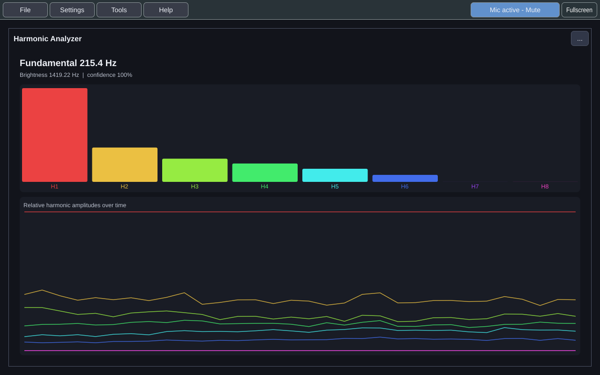

It tells you when it can't give a clean answer, rather than guessing:

- **"Weak fundamental"**: the profile is anchored to the strongest overtone.
- **"Uncertain or inharmonic input"**: the sound isn't a clean pitched tone.
- **Clipping**, **muted** and **disconnected** states are shown as they happen.

## Input Level

How loud your microphone is, measured the way a take hears it. The figure is
the level now; the bar draws it, with a thin mark at the loudest it has been in
the last moment or two. The line across the bar is **Settings → Practice →
Ignore sound below**: sound in the grey part, under the line, is ignored by a
take and never counted as a note; sound that reaches past it, in green, counts
as playing or singing. The words under the figure say which side of the line you
are on. Near full scale the bar turns red: a little louder and the input clips.

The bar runs across the tool, or upright in a tall, thin pane. To choose,
**...** → **Orientation**: **Automatic** (the default), **Horizontal** or
**Vertical**. Each copy of the tool keeps its own choice with the workspace.

To set the line for your room, open the tool, stay silent, and raise the line
until the room sits under it; then sing quietly and check that you cross it.
The same meter is beside **Ignore sound below** in Settings, so you can do it
there too.

## Score View

Draws the open score as engraved notation: staves and grand staves, clefs, key
and time signatures, notes, rests, stems, beams, ties, lyrics, dynamics and tempo
marks, with each part named beside its staves.

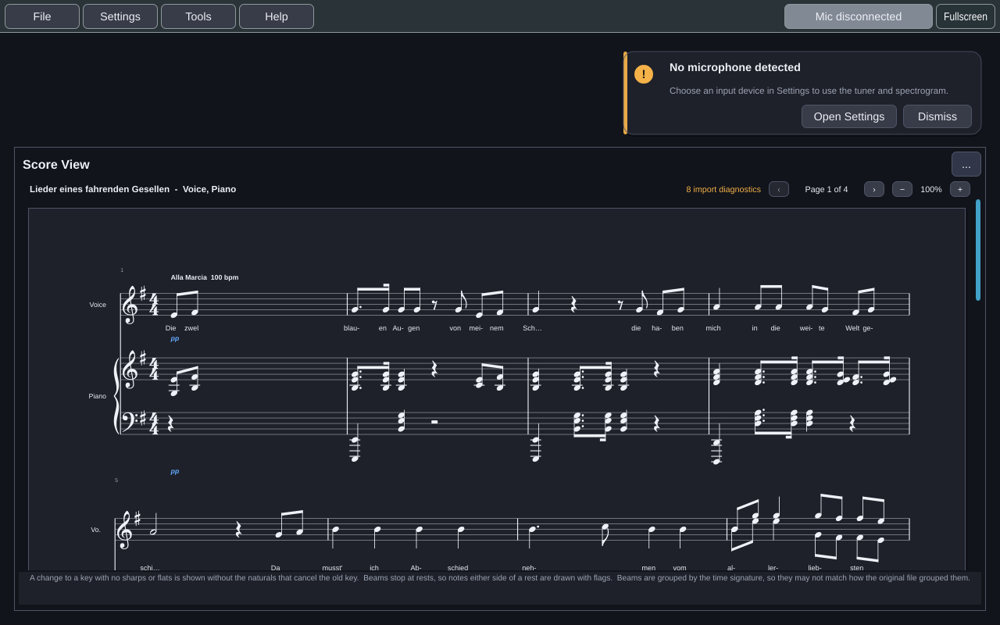

- **Three views:** *Page* (the default, with previous and next page), *Vertical
  scroll* and *Horizontal scroll*.
- **Enlarge**, **Shrink** and **Default size** change the size of the music.
- **Parts** shows and hides individual parts.
- **Fit width** and **Fit page** (Page view) size the page to the panel's width,
  or show the whole page at once.

### Following the practice clock

Play a score with the transport in the title bar (see [[Getting Started]]) and
the Score View follows it:

- A **cursor** marks where the clock is, moving through each note as it sounds.
- The **notes sounding** are tinted, and the **notes coming next** are ringed.
  **Look ahead** in the options menu sets how many onsets ahead, from none to
  four (none by default). Only the parts you show are marked, so hide the piano
  to see only your line.
- The view **follows the clock**. It turns the page in Page view, steps a
  system at a time in Vertical scroll, and moves a screen at a time in
  Horizontal scroll. Scroll or turn a page yourself to look elsewhere: it stops
  following, and a **Follow** button appears in the header until you press it
  or play again. **Follow the practice clock** in the options menu turns it off
  altogether.
- **Click a note** to move the clock there, and **Go to bar…** to move it to a
  bar by its printed number. Every Score View, and the transport, follow.

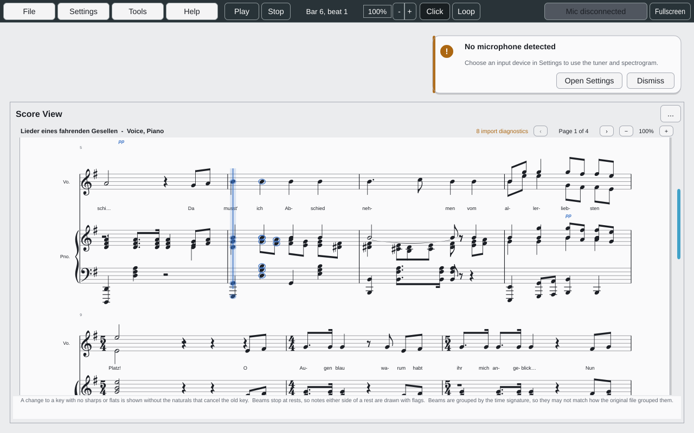

Open a score with **File → Open score...**. Until then it says "No score open".
The header names the work and its parts, and links to the import's notes when
there are any (*8 import diagnostics* above): click it to read them again, in the
same window **Open score** showed them in. A line at the bottom says where the
drawing knowingly differs from the file, such as beams regrouped by the time
signature.

### Marking a take

While a take is under review and its score is open, the Score View marks every
note of the part it was judged against: right, wrong (with the key played),
missed, early or late, and a cross above the staff for each extra key. A sung
note is also marked by how in tune it was: green near perfect, blue within your
acceptable range, amber sharp or flat with an arrow and its cents, red wrong. See
[[Getting Started]] and the Take Review below. **Show take review** in the
options menu turns the marks off.

## Take Review

The take you just played, judged note by note. It shows:
- the take and the part it was judged against, each of which you can change;
- a summary: *158 correct · 7 wrong · 11 missed · 1 extra · 3 early · 4 late*,
  or for a sung take *41 in tune · 6 sharp · 3 flat · …*;
- every result in time order, a sung note with how far off it was:
  *G4 · 18 ¢ sharp*.

Click a result to move the practice clock, and with it the Score View, to that
note. Before the first take it says how to record one.

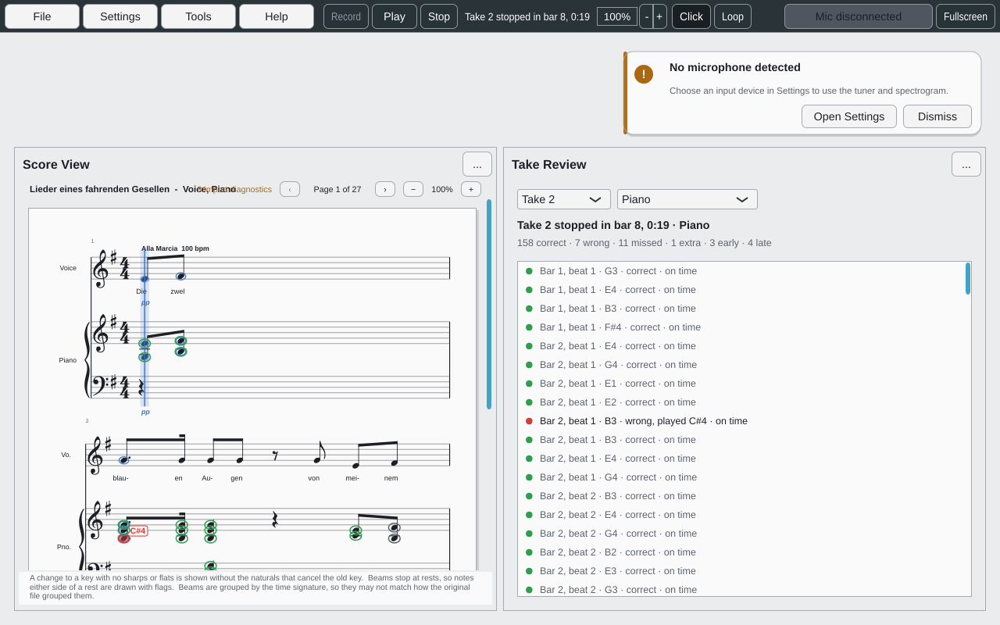

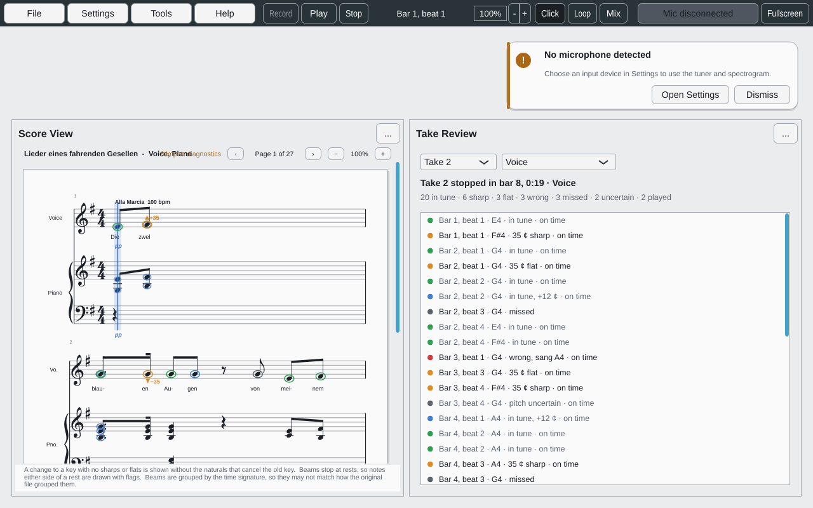

## Target Note (retired)

The Target Note tool showed the first note of the open score. It was replaced by
the target line in the tuner (above), which every tool can read. A workspace
saved with the Target Note tool opens a tuner in its place.

## Two of the same tool

The tuner, the spectrogram, the harmonic analyzer, the Input Level, the Note
View and Now & Next can each be open more than once: two tuners side by side, or two spectrograms at different settings. Each
copy has its own settings, its own analysis and its own place in the workspace.

- **Tools → *tool* → Open another** opens a new copy. **Open or focus** still
  goes to the one already open.
- Copies after the first are numbered: *Tuner*, *Tuner 2*.
- **Rename...**, in the Tools menu or the tool's own **...** menu, gives a copy
  a name of your own, such as *Violin*. Leave the name empty to go back to the
  number. Names are saved with the workspace.
- Once two copies are open, the tool's Tools submenu lists each one by name,
  with its own Dock, Float, Rename and Close.

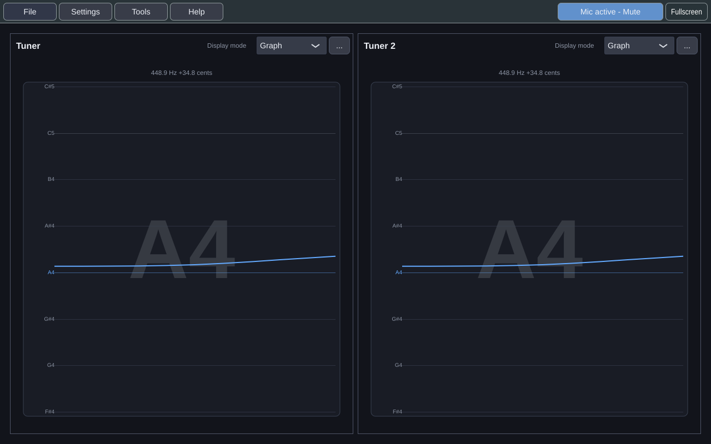

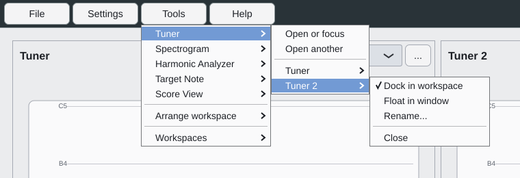

You can have up to six copies of each tool. At six, **Open another** is greyed
out and says *6 is the most*.

Spectrograms, harmonic analyzers and Input Levels each take one of 16 audio
streams from the microphone, and the meter in **Settings → Practice** takes one
while it is on screen. Tuners don't take one, because all tuners share one pitch reading.
If the streams ever run out, **Open another** says *no audio stream free*.
Choosing it tells you which tools are using them, so you know what to close.

The Score View and the Take Review open once each, because every copy would
show the same score or the same take.

## Coming next

Every planned feature is on the [[Features]] page. Among the first:

- **Your vocal range**, found, kept, and drawn against a piece
  ([#298](https://github.com/dwerkjem/PracticeTakes/issues/298)).
- **A reference tone or drone** to sing in tune against
  ([#299](https://github.com/dwerkjem/PracticeTakes/issues/299)).
- **The same tools on a recording.** Record a take, or open an audio file, and
  look at it with every tool above, exactly as you would live: play it, pause
  it, scrub it. Graphs show a whole take at once, with the score's target notes
  laid over the pitch curve
  ([#291](https://github.com/dwerkjem/PracticeTakes/issues/291)).
- **More analysis tools**, each built together with the evaluation that needs
  it: a loudness meter, a sustain and legato analyzer, and a tempo and
  rhythm-stability tool.

The [[Roadmap]] has the order.
