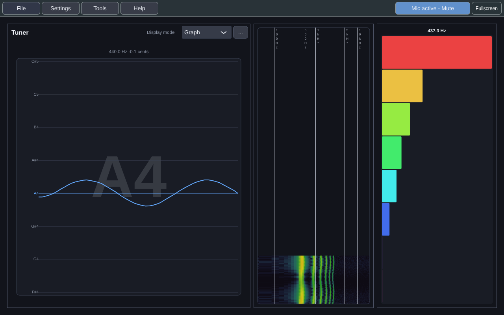
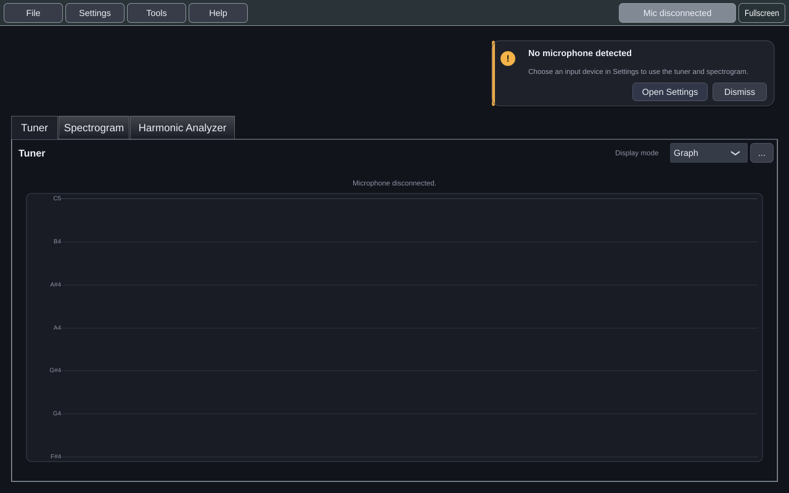
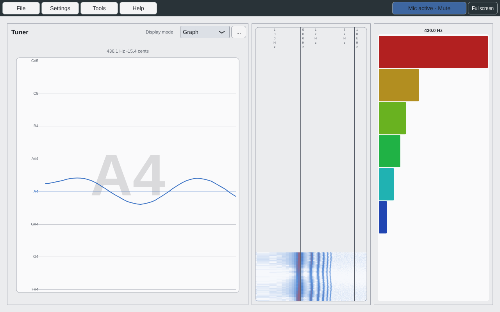

# Workspace and Settings

## Docking, floating and tiling

Each tool runs either inside the main window or in its own resizable floating
window. Moving it between the two doesn't restart it, so it keeps its analysis
and its history.

- **Tools → *tool* → Dock in workspace** or **Float in window** moves a running tool.
- Drag a tool's **Drag** handle into the main window. The targets that appear
  tile it **left**, **right**, **top** or **bottom**, group it as a **tab**, or
  send it back to a floating window.
- Split dividers are resizable.
- **Tools → Arrange workspace** does the same things from the keyboard.
- A tuner, spectrogram or harmonic analyzer can be open more than once, and each
  copy docks, floats and tiles on its own. See [[Tools]].

| Tiled | Tabbed |
|---|---|
|  |  |

## Workspaces

**Tools → Workspaces** has four built-in arrangements:

| Workspace | For |
|---|---|
| Vocal Warm-up | Singing exercises |
| Pitch Practice | Holding notes in tune (also what **Reset to Pitch Practice...** returns to) |
| Spectrum Analysis | Looking at tone |
| Performance Preparation | Running a piece |

You can also save the current arrangement under a name, apply it later,
overwrite or rename it, and delete it. Named workspaces are independent copies.
Resetting the workspace replaces only the *current* arrangement with Pitch
Practice; it doesn't touch your named workspaces or your preferences.

Your layout is restored the next time you start Practice Takes.

## Settings

**Settings** has five tabs:

| Tab | Holds |
|---|---|
| **Appearance** | The theme, **Dark** or **Light**, for every open window |
| **Audio** | Mute, input volume, the live input level, buffer health, the metronome's volume and accent (and why it's silent, if it is), and the input and output devices |
| **MIDI** | The keyboard and the sustain pedal (see [[MIDI Keyboard]]) |
| **Practice** | Practice presets, which set the tuner's behaviour for the material you're practising; how many bars the metronome counts in; the **reference pitch**, A4 = 440 Hz by default, from 415 to 466 Hz; **In tune within**, how close a sung note must be to count as in tune, 25 cents by default, from 5 to 50; and whether a target you chose is kept when a score opens |
| **Reset & support** | **Send feedback**, and reset the current tool, the audio settings, the layout, or all settings, each after a confirmation |

**Import settings**, **Export settings** and **Save settings** sit along the
bottom of every tab.

## Moving settings to another machine

**Settings → Export settings** writes a human-readable `.ptsettings` file. It
contains your appearance, audio, fullscreen, feedback-invitation, tool,
active-workspace and named-workspace settings.

It deliberately leaves out:
- feedback text and contact details;
- installation identity, use counters and invitation history;
- logs, benchmarks and analysis data;
- your MIDI keyboard and pedal setting, because those belong to the machine the
  keyboard is plugged into;
- your output device, the metronome's volume, accent and switch, the
  count-in, playing the score, the reference pitch and the in-tune tolerance,
  for the same reason:
  they belong to this machine's speakers and your habits on it. Importing a file keeps this machine's output device.

**Import** checks and migrates the file, then shows what it would replace.
Nothing changes until you confirm. A confirmed import replaces your supported
preferences and all named workspaces, and takes effect at once.

A file from a newer, unsupported version is refused with a compatibility error,
and nothing is changed. A missing audio device or an off-screen window position
falls back to a safe choice without rejecting the rest of the import.
